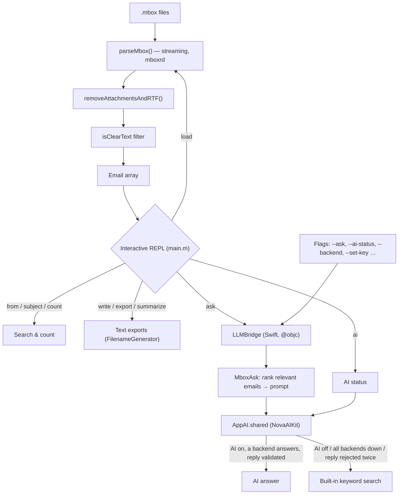
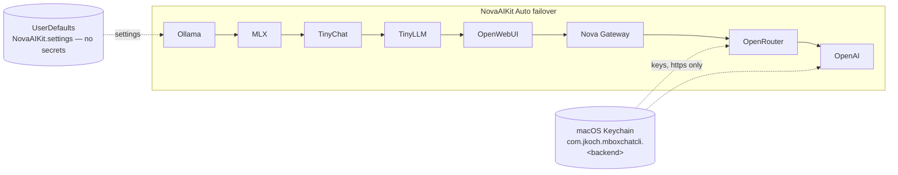

# MboxChatCLI

**Command-line tool for parsing, searching, exporting and asking questions about MBOX email archives**


[](https://opensource.org/licenses/MIT)


A native macOS command-line tool for parsing, searching, threading and exporting MBOX email archives, with an
optional AI "ask" command that answers questions from the loaded emails. The MBOX engine is Objective-C on
Foundation; the AI layer is Swift on [NovaAIKit](https://github.com/kochj23/NovaAIKit) 1.0, the same AI feature set
every Jordan Koch macOS app uses. With AI off (or nothing reachable) every command still works: `ask` falls back to a
built-in keyword search and nothing leaves the Mac.

Current version: **1.1.0** — see [CHANGELOG.md](CHANGELOG.md).

---

## Architecture





---

## Features

| Category | Details |
|----------|---------|
| **MBOX parsing** | Streaming RFC 4155 parser (mboxrd `>From` unescaping, UTF-8 with fallback); From/Subject/Date headers |
| **Multi-file loading** | Combine archives on the command line or with `load` |
| **RTF / attachment stripping** | Removes RTF content, MIME attachments and multipart/mixed sections |
| **Binary filtering** | Messages failing ASCII validation are discarded |
| **Search** | Case-insensitive sender, subject and body keyword counts |
| **Exports** | One file per message, one file per thread, or a per-thread summary |
| **Ask (AI)** | `ask <question>` ranks the loaded emails by keyword relevance, sends the best 8 (bodies capped) as context and prints the answer |
| **AI on/off** | `--ai on\|off` (`--no-ai` for one run). Off = built-in keyword search only |
| **Backends** | Auto, Ollama, MLX, TinyLLM, TinyChat, OpenWebUI, Nova Gateway, OpenRouter, OpenAI — model picker (`--model`, `--list-models`) and editable URLs (`--url B=URL`) |
| **Auto failover** | Local first; per-request timeout (`--timeout`), retries with backoff, health cache — all NovaAIKit |
| **Output validation** | Reasoning blocks removed, plain text, capped at 6,000 characters, echo of the question rejected; one re-ask with the complaint, then the built-in answer |
| **Keys** | Keychain only (`--set-key`, hidden input), sent over https only, never printed; environment variables are never read for keys |
| **Status indicator** | `--ai-status` / REPL `ai`: state dot, active backend and latency, per-backend reachability, key stored/none. Every answer is labelled on stderr: `[AI · Ollama (qwen3:8b)]` or `[Built-in]` |

---

## Commands (REPL)

| Command | Description |
|---------|-------------|
| `load <file>` | Load an additional MBOX file |
| `from <sender>` | Count emails matching a sender |
| `subject <keyword>` | Count emails with keyword in subject |
| `count <keyword>` | Count emails with keyword in body |
| `write <dir>` | Export each message as a separate text file |
| `export <dir>` | Export threads, one file per subject |
| `summarize <dir>` | Write a summary file per thread |
| `ask <question>` | Answer from the loaded emails (AI, or built-in keyword search) |
| `ai` | AI status |
| `help` / `exit` | Help / quit |

---

## Usage

```bash
# Interactive
MboxChatCLI inbox.mbox sent.mbox
> ask when was the Q3 budget approved?
[AI · Ollama (qwen3:8b)]
Carol approved the Q3 budget on Wed, 3 Jul 2024.

> from alice@example.com
Found 87 emails from 'alice@example.com'.

# One-shot (no mailbox context)
MboxChatCLI --ask "Draft a polite follow-up email" --system "You write short emails."

# AI settings — apply to one run, or keep them with --save
MboxChatCLI --backend ollama --model llama3.2:3b --url ollama=http://studio.local:11434 --save
MboxChatCLI --ai off --save          # built-in answers only, nothing leaves the Mac
MboxChatCLI --ai-status
MboxChatCLI --list-models --backend ollama

# Keys (Keychain only; read from stdin with echo off)
MboxChatCLI --set-key openrouter
MboxChatCLI --clear-key openrouter
```

Full flag list: `MboxChatCLI --ai-help`.

---

## AI

MboxChatCLI uses [NovaAIKit](https://github.com/kochj23/NovaAIKit) 1.0 (app id `mboxchatcli`).

| Topic | Behaviour |
|-------|-----------|
| Backends | Auto (default), Ollama, MLX, TinyLLM, TinyChat, OpenWebUI, Nova Gateway, OpenRouter, OpenAI. Google/Azure/AWS/IBM Watson are not supported (they were never functional and were removed). |
| Toggle | `--ai on\|off --save`; `--no-ai` for a single run |
| Fallback | `ask` → built-in keyword search: how many emails match the question's keywords, and the top five (date, sender, subject). With no mailbox loaded it says so. The reason (AI off / backend error / reply rejected) is shown |
| Validation | Non-empty after removing `<think>` blocks, markdown stripped, ≤ 6,000 characters, not just the question echoed |
| Keys | macOS Keychain, service `com.jkoch.mboxchatcli.<backend>`, account `apiKey`; https only |
| Settings | UserDefaults key `NovaAIKit.settings` (no secrets). Flags without `--save` never change saved settings |
| Status | `--ai-status`, REPL `ai`, and a `[source]` line on stderr before every answer |

### Upgrading from 1.0 / the load-balancer build

- The OpenRouter key the old balancer read from AIStudio's Keychain item (`com.jkoch.aistudio.openrouter`) is copied
  once into `com.jkoch.mboxchatcli.openrouter`; AIStudio's item is left in place.
- Old `AIBackend_*` UserDefaults settings are imported once; a plaintext OpenAI key there is moved into the Keychain
  and obsolete Google/Azure/AWS/IBM secrets are deleted.
- `OPENROUTER_API_KEY` is no longer read (keys never come from the environment) — run `--set-key openrouter`.
- `--all-local` → `--backend auto`, `--frontier` → `--backend openrouter`, `--nova-gateway` → `--backend novagateway`.
  `--policy` and `--llm-config` are ignored; Auto fails over in a fixed, local-first order.

---

## Output Formats

**Individual messages** (`write`): From/Subject/Date headers followed by the ASCII body.

**Thread exports** (`export`): all messages sharing a subject in one file, sorted chronologically.

**Thread summaries** (`summarize`): subject, message count, first and last sender with dates, opening and closing
sentences.

---

## Requirements

- macOS 14.0 or later
- Xcode 16+ to build (Swift 6 toolchain for NovaAIKit)
- Optional: a local [Ollama](https://ollama.com) (or any backend above) for `ask`

---

## Build & Install

```bash
git clone git@github.com:kochj23/MboxChatCLI.git
cd MboxChatCLI
xcodebuild build -project MboxChatCLI.xcodeproj -scheme MboxChatCLI -configuration Release \
  -derivedDataPath ../dd-mboxchatcli
cp ../dd-mboxchatcli/Build/Products/Release/MboxChatCLI /usr/local/bin/
```

The only dependency is NovaAIKit (Swift Package Manager, resolved automatically).

---

## Tests

The Swift AI layer is tested with SwiftPM (no network — a stub `URLProtocol` — and an in-memory key store):

```bash
swift test
```

`MboxLLMTests/AIKitAdoptionTests.swift` — 30 tests in seven categories:

| Category | Tests | Covers |
|----------|-------|--------|
| Security | 6 | Keychain service names, env keys ignored, legacy OpenRouter key copied (original kept), plaintext OpenAI key moved out of UserDefaults, no key over http, status never prints keys |
| Performance | 3 | Ranking 20,000 emails, bounded prompt size, offline fallback doesn't hang |
| Retry / failover | 3 | Rejected reply re-asked once then built-in, Auto with everything down, local-first order |
| Unit | 7 | Flag parsing, legacy flags, parse errors, removed clouds → Auto, invocation detection, validator, ranking |
| Integration | 3 | Ask sends only relevant emails to `/api/chat`, legacy settings migration, no old AI client code left |
| Functional | 4 | AI off → built-in answer and nothing sent, offline fallback, no-mailbox fallback, plain one-shot request |
| Frame / UI state | 4 | Status off / offline / online states and symbols, one-run overrides not saved |

`MboxChatCLITests/*.m` hold 132 Objective-C XCTest cases for the MBOX engine (parser, text processing, filenames,
security). They are not attached to an Xcode test target in this project.

---

## Technical Details

- **Parsing:** streaming line reader, splits on `From ` separators (RFC 4155), mboxrd unescaping, headers by prefix.
- **Threading:** grouped by lowercased subject, sorted chronologically.
- **Ask context:** keyword score per email (subject/sender hits ×2, body ×1), top 8, bodies capped at 1,200 characters.
- **Async from a C entry point:** the Swift bridge runs NovaAIKit's main-actor work by spinning the main run loop.

---

## Project Structure

```
MboxChatCLI/
  main.m                        -- Entry point, parser, REPL
  Models/Email.h / .m           -- Email model
  Utilities/TextProcessor.h/.m  -- ASCII validation, stripping, RTF removal
  Utilities/FilenameGenerator   -- Safe filenames
  LLM/AppAI.swift               -- The NovaAI instance + one-time legacy migration
  LLM/MboxAI.swift              -- Flags → settings, ask (prompt, fallback, validator), status report
  LLM/LLMBridge.swift           -- @objc bridge called from main.m
MboxLLMTests/                   -- SwiftPM tests for the AI layer
Package.swift                   -- SwiftPM wrapper (library MboxLLM + tests)
```

---

## License

MIT License. See [LICENSE](LICENSE).

Copyright (c) 2025–2026 Jordan Koch.

---

Written by **Jordan Koch** ([@kochj23](https://github.com/kochj23))
